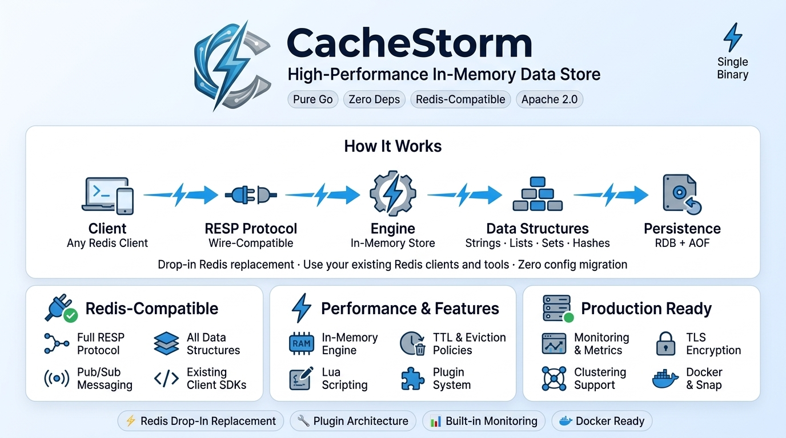

<div align="center">

## CacheStorm

**High-Performance In-Memory Data Store**

  

  [](https://golang.org)
  [](LICENSE)
  [](./docs/commands.md)
  [](COVERAGE_REPORT.md)
  [](./docs/commands.md)

  [](https://github.com/CacheStorm/CacheStorm/actions/workflows/ci.yml)
  [](https://github.com/CacheStorm/CacheStorm/actions/workflows/release.yml)
  [](https://goreportcard.com/report/github.com/cachestorm/cachestorm)
  [](https://cachestorm.com)
</div>

---

A Redis-compatible in-memory data store written in Go, with **tag-based cache invalidation built in**. Point any Redis client at it: strings, hashes, lists, sets, sorted sets, streams, Lua, transactions, pub/sub, replication, cluster mode and persistence behave as they do in Redis. On top of that, every key can carry tags, and one `INVALIDATE` deletes every key of a tag atomically, replicated and persisted like any other write.

About 1,240 commands (the Redis 7.4 set, most of what Redis 8 added, and CacheStorm's own), one static binary, multi-core.

🌐 **[Website](https://cachestorm.com)** | 📖 **[Commands](./docs/commands.md)** | 🚀 **[Getting started](./docs/01-getting-started.md)** | 📊 **[Benchmarks](./docs/BENCHMARKS.md)** | 📝 **[Changelog](./CHANGELOG.md)** | 💬 **[Discussions](https://github.com/CacheStorm/CacheStorm/discussions)**

## Table of Contents

- [Tag-Based Invalidation](#tag-based-invalidation)
- [Features](#features)
- [Quick Start](#quick-start)
- [Installation](#installation-methods)
- [Performance](#performance)
- [Official SDKs](#official-sdks)
- [Docker](#docker)
- [Security](#security)
- [Production Deployment](#production-deployment)
- [Monitoring & Observability](#monitoring--observability)
- [Testing and CI](#testing-and-ci)
- [Configuration](#configuration)
- [Contributing](#contributing)
- [License](#license)

## Tag-Based Invalidation

Caching the result of a query is easy; knowing which cached entries to drop when the data behind them changes is the hard part. On Redis that usually means keeping a set of keys per tag, adding to it on every write, and deleting through a Lua script that reads the set — with sets that outlive their keys and a script that must run on the right node. CacheStorm keeps the tag index itself:

```redis
# Value, expiry and tags in one atomic write (TAGS is the last option)
SET page:/users/7 "<html>..." EX 300 TAGS user:7 pages
SET api:/users/7/orders "[...]" EX 60 TAGS user:7 orders

# Tag an existing key, or set a value with tags (no expiry)
SET session:ab12 "..." EX 1800
ADDTAG session:ab12 user:7
SETTAG report:q3 "..." reports

# Which keys carry a tag, how many, and which tags a key has
TAGKEYS user:7
TAGCOUNT user:7
TAGS page:/users/7

# User 7 changed: drop everything cached for them, in one atomic command
INVALIDATE user:7                  # (integer) 3
INVALIDATE orders pages            # several tags at once; a key counts once

# Tag hierarchies: CASCADE also reaches the child tags
TAGLINK catalog category:shoes
INVALIDATE catalog CASCADE
```

What you can rely on:

- **Atomic**: `INVALIDATE` deletes every key the tags have when it runs; a key tagged concurrently is either deleted or written after it, never left half-invalidated.
- **No stale index**: a key leaves its tags when it is deleted, expires, is evicted, or is overwritten by a plain `SET`. `RENAME`, `COPY`, `MOVE` and `SWAPDB` take its tags along; in-place writes (`APPEND`, `INCR`, `SETRANGE`, `EXPIRE`, ...) keep them.
- **Replicated and persisted**: replicas, the AOF and RDB snapshots carry the tags and the tag hierarchy; `INVALIDATE` reaches replicas as the `DEL`s it caused, so they never depend on their own copy of the index.
- **Observable**: each deleted key publishes the usual `del` keyspace notification, and clients using `CLIENT TRACKING` are told.
- **Cluster-wide**: in a cluster, `INVALIDATE`, `TAGKEYS` and `TAGCOUNT` sent to any node cover every master, and the tag hierarchy is the same on every node, kept in step even across a node's restart; `MIGRATE` and slot migration move a key's tags with it.
- **Fast**: invalidating a tag of 10 keys runs at ~270k ops/s with 8 pipelining clients without stopping other clients' writes, and a tag of 50,000 keys is gone in ~9 ms — about 4x faster than the `SMEMBERS` + `DEL` Lua script the same job takes on Redis. A tag costs a key about 55 bytes.

The [Go, Python and TypeScript SDKs](#official-sdks) wrap these commands (`SetWithTags` / `set(..., tags=[...])` / `setWithTags`, and `Invalidate(tags...)`); with any other client, send them as raw commands. See [the tag commands](./docs/commands.md#tag-based-invalidation-commands) for every option.

## Features

### Redis Compatibility
- **Protocol**: RESP2 and RESP3 (`HELLO 3`, push messages, client-side caching with `CLIENT TRACKING`); go-redis, redis-py, ioredis, Jedis and `redis-cli` work unmodified
- **Data types**: strings, hashes (with field expiration), lists, sets, sorted sets, streams with consumer groups, bitmaps, bitfields, HyperLogLog, geo, plus the Redis Stack/Redis 8 types: JSON, time series, search (`FT.*`), Bloom/Cuckoo filters, Count-Min Sketch, Top-K, t-digest and vector sets
- **Redis 8 additions**: the array type, the conditional string commands (`SET ... IFEQ`, `DELEX`, `DIGEST`), `MSETEX`, `HSETEX`/`HGETEX`, the stream additions and atomic slot migration
- **Measured, not estimated**: CI runs `tests/compat`, which sends the same command sequences to Redis 7.4 and CacheStorm and compares every reply; [its report](tests/compat/REPORT.md) lists the known differences
- **Drop-in data**: loads Redis' `dump.rdb` (up to Redis 8.10's format), its `DUMP` payloads, and a Redis 7 `appendonlydir`; reads `redis.conf`

### Server
- **Persistence**: AOF (`always`/`everysec`/`no`) with rewrite, RDB snapshots with `SAVE`/`BGSAVE` and Redis `save` rules
- **Replication**: `REPLICAOF`, PSYNC full and partial resync, read-only replicas, `WAIT`
- **Cluster mode**: a Redis Cluster node that cluster clients and `redis-cli --cluster` work with: slot table, `nodes.conf`, `MOVED`/`ASK` redirections, gossip and failure detection, automatic and manual failover, online resharding. See [Running a cluster](docs/09-cluster.md)
- **Scripting and transactions**: Lua (`EVAL`, `FUNCTION`), `MULTI`/`EXEC`/`WATCH`
- **Memory management**: `maxmemory` with LRU/LFU/random/TTL eviction policies
- **Security**: TLS, `requirepass`, ACLs with per-user command, key and channel rules, protected mode
- **Observability**: Prometheus metrics, slow log, latency monitor, `INFO`, hot-key tracking, an HTTP API and admin UI

### Extension Commands
CacheStorm's own command modules, whose state lives in ordinary keys (persisted, replicated and expired like any other): circuit breakers, rate limiters and bulkheads, distributed locks and semaphores, promises and futures, windows, aggregators and joins over streams of values, event sourcing, telemetry and alerts, a property graph with read-only Cypher (`GRAPH.QUERY`), and ML feature/embedding storage. See the [Commands Reference](./docs/commands.md); `extension-commands` in the configuration turns them off.

## Quick Start

### One-Click Install

**Linux/macOS:**
```bash
curl -fsSL https://raw.githubusercontent.com/cachestorm/cachestorm/main/scripts/install.sh | bash
```

**Windows:**
```powershell
irm https://raw.githubusercontent.com/cachestorm/cachestorm/main/scripts/install.ps1 | iex
```

**Docker Compose:**
```bash
docker-compose up -d
```

### Using SDKs

**Go:**
```go
import (
	"context"
	cachestorm "github.com/cachestorm/cachestorm/clients/go"
)

ctx := context.Background()
client, _ := cachestorm.NewClient("localhost:6380")
client.Set(ctx, "key", "value", 0)
val, _ := client.Get(ctx, "key")
```

**TypeScript:**
```typescript
import { CacheStormClient } from '@cachestorm/client';

const client = new CacheStormClient({ host: 'localhost', port: 6380 });
await client.connect();
await client.set('key', 'value');
const val = await client.get('key');
```

**Python:**
```python
from cachestorm import CacheStormClient

client = CacheStormClient(host='localhost', port=6380)
client.set('key', 'value')
val = client.get('key')
```

**Redis CLI:**
```bash
redis-cli -p 6380 SET mykey myvalue
redis-cli -p 6380 GET mykey
```

## Installation Methods

### One-Click Installers

| Platform | Method | Command |
|----------|--------|---------|
| Linux/macOS | Docker (recommended) | `curl -fsSL .../install.sh \| bash -s -- docker` |
| Linux/macOS | Binary | `curl -fsSL .../install.sh \| bash -s -- binary` |
| Linux/macOS | Source | `curl -fsSL .../install.sh \| bash -s -- source` |
| Windows | Docker (recommended) | `irm .../install.ps1 \| iex -Method docker` |
| Windows | Binary | `irm .../install.ps1 \| iex -Method binary` |
| Windows | Source | `irm .../install.ps1 \| iex -Method source` |

### Manual Installation

#### From Source
```bash
git clone https://github.com/CacheStorm/CacheStorm
cd cachestorm
go build -o cachestorm ./cmd/cachestorm
./cachestorm
```

#### Using Go Install
```bash
go install github.com/cachestorm/cachestorm/cmd/cachestorm@latest
```

#### Using Docker
```bash
# Build from the included Dockerfile
docker build -t cachestorm .
# Without a password the server only serves loopback clients (protected
# mode), so a container started without one refuses every client outside it.
docker run -d -p 6380:6380 -p 127.0.0.1:8080:8080 \
  -e CACHESTORM_REQUIREPASS='a-strong-password' cachestorm
```

#### Using Docker Compose
```bash
# With monitoring (Prometheus + Grafana)
docker-compose --profile monitoring up -d

# With GUI (Redis Insight)
docker-compose --profile gui up -d

# All features
docker-compose --profile gui --profile monitoring up -d
```

#### From Releases
Download pre-built binaries from [GitHub Releases](https://github.com/CacheStorm/CacheStorm/releases).

### Uninstall

```bash
# Linux/macOS
curl -fsSL https://raw.githubusercontent.com/cachestorm/cachestorm/main/scripts/install.sh | bash -s -- uninstall

# Windows
irm https://raw.githubusercontent.com/cachestorm/cachestorm/main/scripts/install.ps1 | iex -Method uninstall
```

## Examples

Working examples for all SDKs:

```bash
# Start CacheStorm
docker-compose up -d

# Go example
cd examples/go
go run main.go

# Python example
cd examples/python
pip install -r requirements.txt
python demo.py

# TypeScript example
cd examples/typescript
npm install
npm run demo

# Tag-based invalidation with redis-cli
bash examples/tag_examples.sh
```

See [examples/](./examples/) directory for complete working examples.

## Performance

CacheStorm runs commands on every core; Redis runs them on one. Measured with `redis-benchmark` over loopback on an 8-core Ryzen 7 PRO 6850H, one million distinct keys, 50 clients, pipelines of 16 ([method and history](./docs/BENCHMARKS.md)):

| Command | CacheStorm | Redis 7.4 | CacheStorm p50 | Redis p50 |
|---|---|---|---|---|
| SET | 869,565/s | 627,353/s | 0.50 ms | 1.10 ms |
| GET | 1,016,260/s | 753,580/s | 0.38 ms | 0.91 ms |
| INCR | 933,707/s | 634,518/s | 0.45 ms | 1.08 ms |

Writes to one key run one at a time on any server, and there Redis' compact encodings still win (`HSET` on a single hash of 600k fields: 352k/s against 558k/s).

Tag operations, 8 pipelining clients (depth 32), same machine:

| Operation | Throughput / latency |
|---|---|
| `SETTAG key value t u` | ~800k ops/s |
| `ADDTAG key t` | ~950k ops/s |
| `INVALIDATE` of a 10-key tag | ~270k ops/s, other clients keep writing |
| Cache mix: 8 `GET` + `SETTAG` + `INVALIDATE` | ~1.45M commands/s |
| `INVALIDATE` of a 50,000-key tag | ~9 ms (the Redis-style `SMEMBERS` + `DEL` Lua script: ~36 ms) |
| Memory per tag on a key | ~55 bytes |

## Docker

### Quick Start with Docker
```bash
# Pull and run
# Without a password the server only serves loopback clients (protected
# mode), so a container started without one refuses every client outside it.
docker run -d -p 6380:6380 -p 127.0.0.1:8080:8080 --name cachestorm \
  -e CACHESTORM_REQUIREPASS='a-strong-password' ghcr.io/cachestorm/cachestorm:latest
```

### Docker Compose (Full Stack)
```bash
# Clone repository
git clone https://github.com/CacheStorm/CacheStorm
cd cachestorm

# Basic setup (the compose file requires the password)
export CACHESTORM_REQUIREPASS='a-strong-password'
docker-compose up -d

# With monitoring (Prometheus + Grafana)
docker-compose --profile monitoring up -d

# With GUI (Redis Insight)
docker-compose --profile gui up -d

# Everything
docker-compose --profile gui --profile monitoring up -d
```

### Docker Commands
```bash
# Build image
docker build -t cachestorm .

# Run container
docker run -d \
  --name cachestorm \
  -p 6380:6380 \
  -p 127.0.0.1:8080:8080 \
  -e CACHESTORM_REQUIREPASS='a-strong-password' \
  -v cachestorm-data:/data \
  ghcr.io/cachestorm/cachestorm:latest

# With custom config
docker run -d \
  --name cachestorm \
  -p 6380:6380 \
  -v $(pwd)/config:/etc/cachestorm \
  ghcr.io/cachestorm/cachestorm:latest \
  --config /etc/cachestorm/cachestorm.yaml
```

### Docker Compose

```yaml
version: '3.8'
services:
  cachestorm:
    image: ghcr.io/cachestorm/cachestorm:latest
    ports:
      - "6380:6380"
      - "8080:8080"
    volumes:
      - cachestorm-data:/data
    environment:
      - CACHESTORM_MAX_MEMORY=4gb
    healthcheck:
      test: ["CMD", "wget", "-q", "--spider", "http://localhost:8080/api/health"]
      interval: 30s
      timeout: 3s
      retries: 3

volumes:
  cachestorm-data:
```

## Security

For full details, see [SECURITY.md](./SECURITY.md).

CacheStorm includes built-in security features for production deployments:

- **TLS 1.2+** with hardened cipher suites (AEAD-only: AES-GCM, ChaCha20-Poly1305) and secure curve preferences
- **Authentication** via `requirepass` for RESP protocol and password-protected HTTP API with constant-time comparison
- **ACL System** with per-user command, key, and channel permissions
- **HTTP API Hardening** including command blacklists (SHUTDOWN, FLUSHALL, DEBUG, CONFIG blocked), per-IP rate limiting, and request body size limits
- **Input Validation** with key name validation, value size limits, integer overflow protection, and RESP protocol bounds

To report a vulnerability, use [GitHub Security Advisories](https://github.com/CacheStorm/CacheStorm/security/advisories/new) -- do not open public issues for security concerns.

## Production Deployment

### Configuration

Copy the production configuration template and adjust values for your environment:

```bash
cp config/cachestorm.production.yaml config/cachestorm.yaml
```

See [`config/cachestorm.production.yaml`](./config/cachestorm.production.yaml) for the full reference with recommended production settings including authentication, persistence, memory limits, and logging.

Key production settings to configure:
- `server.requirepass` -- set a strong password for RESP authentication
- `http.password` -- set a strong password for the HTTP API
- `server.tls_cert_file` / `server.tls_key_file` -- enable TLS encryption
- `memory.max_memory` -- set an appropriate memory limit (e.g., `"1gb"`, `"4gb"`)
- `persistence.enabled: true` -- enable AOF persistence
- `logging.format: "json"` -- use structured JSON logging for log aggregation

### Docker Deployment

The project includes a production-ready [`docker-compose.yml`](./docker-compose.yml) with resource limits, health checks, and optional monitoring services.

```bash
# Basic production deployment
docker-compose up -d

# With Prometheus + Grafana monitoring
docker-compose --profile monitoring up -d

# With Redis Insight GUI
docker-compose --profile gui up -d

# Full stack (all services)
docker-compose --profile gui --profile monitoring up -d
```

The Docker Compose configuration includes:
- Memory and CPU resource limits (2GB / 2 CPUs by default)
- Automatic restarts (`unless-stopped`)
- Health checks against `/api/health`
- Admin API (port 8080) bound to localhost only
- Read-only config volume mount

### Health Check Endpoints

CacheStorm exposes two unauthenticated health endpoints on the HTTP API (port 8080):

| Endpoint | Purpose | Description |
|----------|---------|-------------|
| `GET /api/health` | Liveness probe | Returns `200 OK` if the server process is running |
| `GET /api/ready` | Readiness probe | Returns `200 OK` when the server is ready to accept traffic |

Use these for Docker health checks, Kubernetes probes, or load balancer health checks:

```yaml
# Kubernetes example
livenessProbe:
  httpGet:
    path: /api/health
    port: 8080
  initialDelaySeconds: 5
  periodSeconds: 30
readinessProbe:
  httpGet:
    path: /api/ready
    port: 8080
  initialDelaySeconds: 5
  periodSeconds: 10
```

### Monitoring Setup (Prometheus + Grafana)

The `docker-compose.yml` includes optional Prometheus and Grafana services under the `monitoring` profile:

```bash
docker-compose --profile monitoring up -d
```

This starts:
- **Prometheus** on port `9090` -- scrapes CacheStorm metrics automatically via `monitoring/prometheus.yml`
- **Grafana** on port `3000` -- pre-configured with dashboards from `monitoring/grafana/dashboards/`

Default Grafana credentials: `admin` / `admin` (change immediately in production).

## Monitoring & Observability

### Prometheus Metrics

CacheStorm exposes a Prometheus-compatible metrics endpoint:

```
GET http://localhost:8080/api/metrics
```

This endpoint requires authentication (session token or HTTP API password). It provides metrics including command throughput, memory usage, connection counts, and latency histograms.

Example Prometheus scrape configuration:

```yaml
scrape_configs:
  - job_name: 'cachestorm'
    scrape_interval: 15s
    static_configs:
      - targets: ['cachestorm:8080']
    metrics_path: /api/metrics
```

### pprof Debug Endpoints

Go pprof profiling endpoints are available for runtime diagnostics (authentication required):

| Endpoint | Description |
|----------|-------------|
| `GET /debug/pprof/` | Index of available profiles |
| `GET /debug/pprof/cmdline` | Command line arguments |
| `GET /debug/pprof/profile` | CPU profile (30s default) |
| `GET /debug/pprof/symbol` | Symbol lookup |
| `GET /debug/pprof/trace` | Execution trace |

Usage example:

```bash
# Collect a 30-second CPU profile
go tool pprof http://localhost:8080/debug/pprof/profile

# View heap profile
go tool pprof http://localhost:8080/debug/pprof/heap
```

### Structured JSON Logging

Set `logging.format: "json"` in the configuration to enable structured JSON logs suitable for log aggregation systems (ELK, Loki, Datadog, etc.):

```yaml
logging:
  level: "info"
  format: "json"
  output: "stderr"
```

### Slow Log

Enable the slow log to identify commands exceeding a latency threshold:

```yaml
plugins:
  slowlog:
    enabled: true
    threshold: "10ms"
    max_entries: 1000
```

Query the slow log via the `SLOWLOG GET` command from any Redis client.

## Testing and CI

```bash
go test ./internal/...              # unit and end-to-end server tests
go test ./internal/... -race        # what CI runs
go test ./benchmarks/ -bench . -benchmem
golangci-lint run
```

Every push runs, in [CI](.github/workflows/ci.yml): build, `go vet` (also as 32-bit), gofmt, golangci-lint, the race-enabled test suite (and again with `-count=3` to catch order dependence), govulncheck, the three SDKs' tests, the Redis compatibility comparison against `redis:7.4-alpine`, and smoke tests with real Redis tooling — go-redis, redis-py and ioredis, master/replica replication, Redis Sentinel failover, `redis-cli --cluster`, persistence recovery and the Docker image. Statement coverage of the internal packages is about 86% (see [COVERAGE_REPORT.md](./COVERAGE_REPORT.md)).

A version tag (`v*`) runs the [release workflow](.github/workflows/release.yml): binaries for linux (amd64, arm64, armv7), macOS (amd64, arm64), Windows (amd64) and FreeBSD (amd64) with a `checksums.txt`, and multi-arch (amd64, arm64) Docker images on `ghcr.io/cachestorm/cachestorm`.

## Configuration

```yaml
# cachestorm.yaml
server:
  bind: "0.0.0.0"
  port: 6380
  max_connections: 10000
  requirepass: ""              # Set password for AUTH
  tls_cert_file: ""            # Path to TLS certificate
  tls_key_file: ""             # Path to TLS private key
  read_timeout: "5m"
  write_timeout: "5m"

http:
  enabled: true
  port: 8080
  password: ""                 # HTTP API auth password

memory:
  max_memory: "0"              # 0 = unlimited, or e.g. "4gb"
  eviction_policy: "allkeys-lru"  # noeviction, allkeys-lru, allkeys-lfu, volatile-lru, allkeys-random
  pressure_warning: 70
  pressure_critical: 85
  eviction_sample_size: 5

persistence:
  enabled: false
  aof: true
  aof_sync: "everysec"         # always, everysec, no
  data_dir: "/var/lib/cachestorm"

replication:
  role: "master"               # master, or replica to follow master_host:master_port
  master_host: ""
  master_port: 6380
  master_auth: ""              # the master's requirepass
  read_only: true              # replicas refuse client writes
  repl_timeout: 60             # seconds of silence before a link is dropped
  backlog_size: 1048576        # bytes kept for partial resynchronization
  replica_buffer_limit: 67108864  # bytes queued per replica before it is dropped

cluster:
  enabled: false               # true runs a Redis Cluster node

logging:
  level: "info"
  format: "json"
  output: "stdout"
```

## Contributing

We welcome contributions! Please see [CONTRIBUTING.md](CONTRIBUTING.md) for guidelines.

1. Fork the repository
2. Create a feature branch (`git checkout -b feature/amazing-feature`)
3. Commit your changes (`git commit -m 'Add amazing feature'`)
4. Push to the branch (`git push origin feature/amazing-feature`)
5. Open a Pull Request

### Development Setup

```bash
# Clone your fork
git clone https://github.com/your-username/cachestorm
cd cachestorm

# Install dependencies
go mod download

# Run tests
go test ./internal/... -v -race -coverprofile=coverage.out

# Run linter
golangci-lint run

# Build
go build -o cachestorm ./cmd/cachestorm
```

## Official SDKs

CacheStorm provides official SDKs for popular programming languages:

| Language | Package | Installation | Documentation |
|----------|---------|--------------|---------------|
| **Go** | `github.com/cachestorm/cachestorm/clients/go` | `go get github.com/cachestorm/cachestorm/clients/go` | [Go SDK](./clients/go/README.md) |
| **TypeScript** | `@cachestorm/client` | from source: `cd clients/typescript && npm ci && npm run build` | [TypeScript SDK](./clients/typescript/README.md) |
| **Python** | `cachestorm` | from source: `pip install ./clients/python` | [Python SDK](./clients/python/README.md) |

The TypeScript and Python packages are not published to npm or PyPI yet.

### SDK Features

| | Go | TypeScript | Python |
|---|---|---|---|
| RESP2, binary-safe values | ✅ | ✅ | ✅ |
| Pipelines (one write, replies in order) | ✅ | ✅ | ✅ |
| Pub/Sub on a dedicated connection | ✅ | ✅ | ✅ |
| Connection pool | ✅ | — | ✅ |
| AUTH / SELECT on connect | ✅ | ✅ | ✅ |
| Automatic reconnection | — | — | — |

Each SDK's README lists its limitations.

### Using Any Redis Client

CacheStorm speaks RESP2 and RESP3, so existing Redis clients work. Compatibility is measured, not estimated: `tests/compat` runs the same command sequences against Redis 7.4 and CacheStorm and compares every reply; [its report](tests/compat/REPORT.md) lists the known differences.

```python
# Python with redis-py
import redis
r = redis.Redis(host='localhost', port=6380)

# Node.js with ioredis
const Redis = require('ioredis');
const redis = new Redis({ port: 6380 });

# Go with go-redis
import "github.com/redis/go-redis/v9"
rdb := redis.NewClient(&redis.Options{Addr: "localhost:6380"})

# Java with Jedis
Jedis jedis = new Jedis("localhost", 6380);

# C# with StackExchange.Redis
var redis = ConnectionMultiplexer.Connect("localhost:6380");
```

## Project Structure

```
cachestorm/
├── cmd/cachestorm/        # Server entry point
├── internal/
│   ├── command/           # Command handlers (1,238 commands), tag commands in tag_commands.go
│   ├── store/             # Sharded keyspace, value encodings, tag index, eviction
│   ├── server/            # Connections, write gate, persistence wiring, cluster slot migration
│   ├── resp/              # RESP2/RESP3 protocol
│   ├── persistence/       # AOF and RDB
│   ├── replication/       # Master-replica replication (PSYNC, backlog, master link)
│   ├── cluster/           # Cluster state, nodes.conf and the cluster bus
│   ├── sentinel/          # Built-in Sentinel role
│   ├── search/            # FT.* search engine
│   ├── vectorset/         # Vector sets (HNSW)
│   ├── graph/             # Property graph and Cypher
│   ├── acl/               # Access control lists
│   ├── config/            # YAML and redis.conf configuration
│   └── ...                # logger, plugin, module, hashslot and helpers
├── clients/               # Official SDKs: go/, python/, typescript/
├── plugins/               # Metrics and other plugins
├── tests/                 # Integration tests and the Redis compatibility harness (tests/compat)
├── benchmarks/            # Go benchmarks for RESP, the store and tags
├── examples/              # SDK and redis-cli examples (tag_examples.sh)
├── scripts/               # Installers and CI smoke tests
├── docs/                  # Documentation
├── config/                # Configuration examples
└── docker/                # Docker files
```

## License

This project is licensed under the MIT License - see the [LICENSE](LICENSE) file for details.

---

<div align="center">
  <sub>Built with ❤️ by the CacheStorm Team</sub>
</div>
